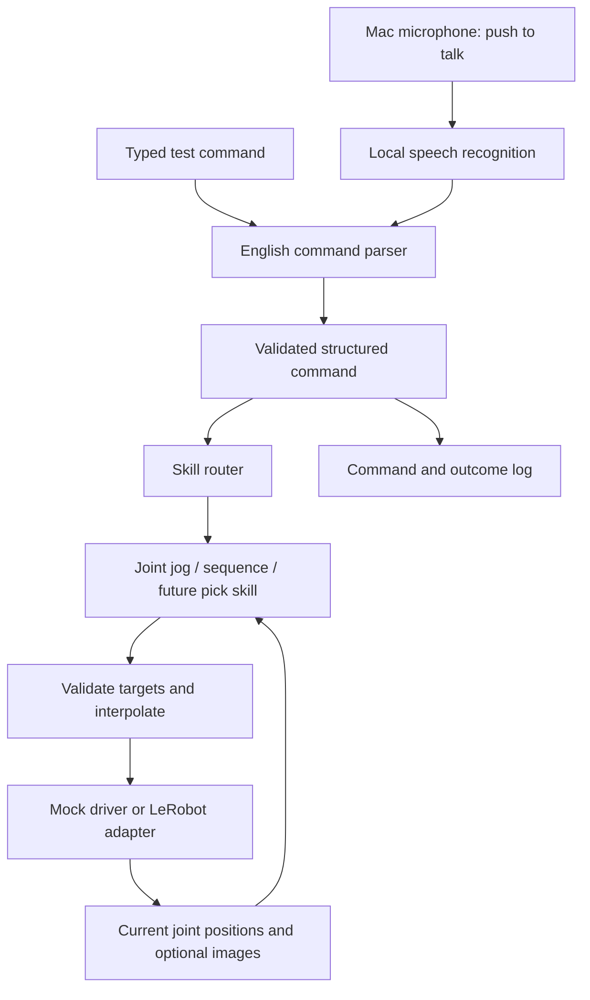

# SO101 English voice-control harness

Research and design proposal, 2026-10-27, Asia/Hong_Kong. Implementation has not started.

## Goal and scope

Build a Mac-hosted program that accepts a small English command vocabulary and produces controlled SO101 actions. Teammates own motor setup. Ivan can develop command tests independently using typed input, recorded audio and mock robot state.

First milestone: left, right, up, down and a proposed stop command. Later milestones: a predefined dance sequence and visually guided picking of a red ball at different tabletop positions.

Confirmed hardware: leader and follower, one arm-mounted camera, Mac and USB connection. The current host reports Apple M3 and 16 GiB RAM. Camera type and mounting arm remain unknown. ESP32 audio is an optional future input/output device.

## What the converter should produce

“Move left” becomes structured data:

```json
{"type":"jog_joint","joint":"shoulder_pan","direction":"left","steps":1}
```

This is our proposed command format, not LeRobot's native input. A joint executor reads current joint positions and uses a configured step magnitude and physically verified direction sign to calculate a target. It then interpolates toward that target and submits numerical action dictionaries through LeRobot.

For example, with a MOCK current pan position of 10 degrees, a MOCK left sign of +1 and a MOCK step size of 5 degrees, the pan target would be 15 degrees. These numbers do not specify an approved movement on the real arm.

An action dictionary is data, not generated Python source to execute. A grasp or dance requires a timed sequence of targets. The controller observes current state during execution; it does not assume the arm instantly reaches a commanded pose.

Official source confirms `get_observation()` reads joint positions and configured cameras; `send_action()` writes joint position goals. The inspected configuration defaults to degrees for the five body joints, with a normalized 0–100 gripper. Older environments may differ. Match the team's actual version and calibration before integration. [Driver](https://github.com/huggingface/lerobot/blob/dd5313e305ff7aaa5b6c7b4769d1b26650ce250b/src/lerobot/robots/so_follower/so_follower.py), [configuration](https://github.com/huggingface/lerobot/blob/dd5313e305ff7aaa5b6c7b4769d1b26650ce250b/src/lerobot/robots/so_follower/config_so_follower.py).

## Reusable resources and recommended roles

| Resource | What it supplies | Recommendation and limits |
| --- | --- | --- |
| [LeRobot](https://huggingface.co/docs/lerobot/so101) | SO101 drivers, calibration and learning workflows | Reuse its hardware interface; do not write a new servo protocol. Pin to the team's working version. |
| [whisper.cpp](https://github.com/ggml-org/whisper.cpp) | Local speech recognition, with Apple Silicon/Metal support | Preferred Mac ASR candidate. Benchmark a small English model on classroom recordings before choosing model size. Python can invoke its CLI or local server. |
| [faster-whisper](https://github.com/SYSTRAN/faster-whisper) | Python ASR through CTranslate2, CPU/int8 support | Alternative if simpler Python integration wins. Do not assume Apple GPU acceleration from its CUDA support. |
| [OpenCV color segmentation](https://docs.opencv.org/4.x/da/d97/tutorial_threshold_inRange.html) | Finds pixels within a color range | Simple red-object baseline for controlled lighting. Color alone does not establish that an object is a ball or identify a grasp point. |
| [Grounding DINO](https://huggingface.co/docs/transformers/model_doc/grounding-dino) | Pretrained text-conditioned object detection | Candidate for finding objects described by text. Its image boxes are not robot coordinates or grasp trajectories; test color/shape discrimination locally. |
| [SmolVLA](https://huggingface.co/docs/lerobot/smolvla) | Camera images + robot state + language instruction → action chunks | Strong future learned-skill candidate. Official workflow recommends around 50 task demonstrations as a starting point and fine-tuning for the setup. This is not a guarantee of success or automatic training from the words “red ball.” |
| [ACT](https://huggingface.co/docs/lerobot/act) | Learns actions from demonstrations | Candidate for a dedicated pick skill selected by the command router. Do not assume ordinary ACT directly understands arbitrary spoken task descriptions. |
| [MolmoAct2 SO100/101 deployment](https://huggingface.co/docs/lerobot/molmoact2) | Existing pretrained SO100/101 policy and LeRobot deployment path | Future comparison option. The documented implementation requires NVIDIA GPU hardware and specific camera/calibration handling, so it is outside the initial Mac-only stack. Published benchmark results do not establish red-ball success in classroom 5110. |

Two relevant community examples were inspected:

- [Argus](https://github.com/biconcavelens/argus-desk-robot-assistant-arm): actual Python policy dispatch, ACT inference, `send_action()` calls and separate gesture code. Useful architectural reference for learned skills plus predefined gestures. Its intent classifier uses an external DeepSeek API; the system is not fully offline. Hardware and trained tasks differ from ours. Inspected revision: `4e02c42f90067a7e4e8fcc31c182e0483dee4d81`. No local reproduction performed.
- [SO101 Speech Controlled with SmolVLA](https://github.com/fouad1233/SO101_Speech_controlled_robotic_arm_with_smolvla): speech/parsing/inference examples, including LIBERO evaluation. The inspected `test_scripts/main.py` uses a simulated KUKA arm with seven joints; it cannot be treated as a working six-actuator SO101 adapter. Useful as a reference, not a drop-in dependency. Inspected revision: `5fa1ec50e55d376d5f4843202fd177af321292ee`. No root license file appeared in the inspected tree; do not copy its code without resolving reuse terms.

## Proposed architecture



Recommended implementation: Python application, one process initially, with replaceable ASR, observation and robot adapters. A deterministic parser is sufficient for the initial vocabulary. An LLM can be evaluated later for broader language, with the same constrained command format.

The parser normalizes recognized phrases and maps them to an allowlist. It must not use naive keyword matching that turns “do not move left” into movement. Unsupported compound commands are rejected initially.

The executor is the single owner of robot writes. ASR and command reception remain responsive while a skill runs. Stop cancels pending movement and further trajectory steps. The exact physical hold behavior needs the team's tested driver configuration; a spoken stop is a software request, not a hardware emergency stop.

Initially use laptop audio and push to talk. “Hey robot” can be an optional text prefix; always-listening wake-word detection is a separate later feature. If ESP32 is added, transport audio and playback requests between it and the Mac. Keep command interpretation and robot control on the Mac; its board-specific audio implementation is a later decision. [Espressif audio framework](https://github.com/espressif/esp-adf).

## Proposed initial command contract

| Phrase | Meaning in milestone 1 | Still to verify |
| --- | --- | --- |
| move left / left | Jog `shoulder_pan` one step toward configured left | Viewpoint and motor sign |
| move right / right | Jog `shoulder_pan` one step toward configured right | Opposite sign |
| move up / up | Jog `shoulder_lift` one step toward configured up | Physical sign and valid range |
| move down / down | Jog `shoulder_lift` one step toward configured down | Opposite sign |
| stop | Cancel queued and ongoing trajectory commands | Driver-specific physical hold behavior |

These meanings are a proposal based on Ivan's request for single-joint commands. They do not mean straight-line movement of the gripper in Cartesian space. That would require coordinated joints and inverse kinematics: calculating joint positions for a desired tool position.

## Requirements and checks for review

1. Accept both typed English and microphone input through the same parser. Typed mode requires neither microphone nor robot.
2. Treat each movement phrase as one bounded step. Do not continue moving indefinitely after a single utterance.
3. Keep joint directions, step magnitude, units and limits in an explicit robot profile. Refuse real execution if that profile is incomplete or state is unavailable/stale.
4. Validate joint names, finite numeric values, target bounds and per-step movement. Do not silently execute an altered, larger or opposite command.
5. Keep mock and physical drivers separate. Mock mode must never open the robot USB port.
6. Serialize robot actions and handle stop without waiting for a whole dance or grasp to finish. Do not queue more motion after stop; require a new movement command to resume.
7. Log transcript, parsed command, state used, planned and submitted targets, and completion/failure. A successful write is not proof that movement or grasping succeeded.
8. Expose camera observations for later skills, but do not make camera availability a dependency of the initial joint commands.

Quality checks: all specified text cases must match their expected interpretation, rejected commands must produce zero movement writes, and mock execution must preserve uninvolved joints. For ASR, propose a small set of recorded classroom utterances and report command accuracy and latency separately. Agree numerical ASR and physical-task targets after measuring an initial baseline.

The accompanying JSON is a test specification only. Neither parser tests nor ASR tests have been executed because there is no implementation yet.

## Route to the red-ball skill

With a moving ball, a fixed recording of joint angles is insufficient. Choose between:

- Camera detection + geometric grasping: determine the ball's position in the robot frame, choose a grasp, solve joint positions and follow a trajectory. A wrist RGB camera needs camera-to-robot calibration and a depth strategy such as known tabletop geometry and ball size, or additional depth sensing. A 2D image box is insufficient by itself. LeRobot already contains [Placo-based kinematics](https://github.com/huggingface/lerobot/blob/dd5313e305ff7aaa5b6c7b4769d1b26650ce250b/src/lerobot/model/kinematics.py), but geometry, reachability and path checks still need implementation.
- A learned visual skill: record leader/follower demonstrations, train or fine-tune ACT/SmolVLA, and evaluate held-out ball positions. This avoids hand-coding every grasp trajectory but requires task data and suitable training compute. Recognizing an object and physically grasping it remain different capabilities.

No grasping backend is selected yet. The immediate harness can be built without choosing one. Later success must mean the ball is actually lifted and held, not simply that six numbers were generated.

## Next implementation proposal

Build typed commands → parser → mock joint state → target preview first. Then add Mac microphone transcription, and only after the team's setup is known integrate the real LeRobot adapter. No model training is required for the initial joint vocabulary. Keep dance and ball picking as subsequent registered skills.

Required team handoff: classmate's file, LeRobot version/revision, Python environment, follower ID and port, applicable calibration file, unit mode and camera configuration. No hardware was accessed during this research.
