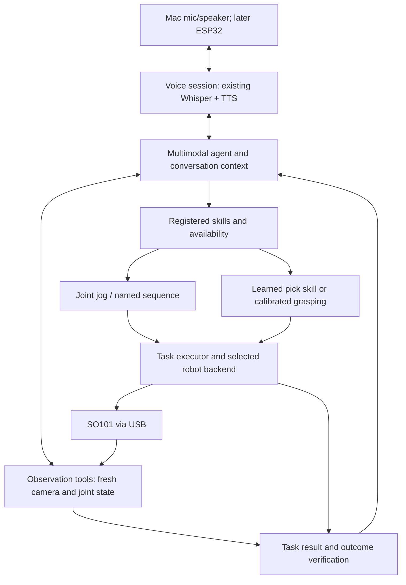

# SO101 multimodal robot agent: infrastructure research and architecture proposal

Updated 2026-10-27, Asia/Hong_Kong. Current proposal; previous joint-only design is preserved in `_old/2026-10-27_joint-only-proposal/`.

## Objective and confirmed requirements

Build an extensible English-speaking robot assistant using existing infrastructure. It should hear a request, inspect the workspace when needed, select an available robot capability, execute it, and report what happened. Basic joint commands are one capability within this architecture.

- Hardware: SO101 leader and follower in classroom 5110, one camera on one arm, initially USB-connected to the Mac. Camera details remain unverified.
- Host: Apple M3 Mac, 16 GiB RAM, verified locally earlier in this session.
- Ivan already has a local Whisper model. Its package, model path and callable interface have not been inspected.
- Cloud speech, vision and reasoning are acceptable. Provider/model choice remains open; new paid usage still needs an agreed cost.
- Desired capabilities: joint jogging, predefined sequences such as dance, visual object recognition, later picking a red ball at varying tabletop positions, and spoken responses to missing objects or failed tasks.
- ESP32 microphone/speaker may become a future frontend. Exact chip and board remain unknown.
- Teammates own motor bring-up. This research does not install services or operate the arms.

## Research method and evidence

Compared existing solutions by SO101 relevance, available source, Mac compatibility, conversational I/O, perception, skill execution, learning workflow, and adaptation effort. Checked documentation against selected implementation files rather than treating a demo description as a complete implementation.

Evidence labels below mean **documented** in primary sources or **source inspected** at the pinned revisions. Platform deployments and model pipelines have not been reproduced locally. A subsequent Cyberwave development environment and offline checks are described below. Published success targets are not measured performance for our classroom setup.

## Shortlist: what exists and what we would reuse

### 1. Cyberwave Python natural-language controller: first candidate

[Tutorial](https://docs.cyberwave.com/tutorials/so101-natural-language-agent) and [source example](https://github.com/cyberwave-os/cyberwave-python/tree/85937673a4ef45bedffefb2af2047851d81ae5ed/examples/nl_arm_controller).

Source inspected: voice capture/STT, camera capture, multimodal planner, JSON plan validation, motion executor and agent loop. The reference uses Mistral Voxtral for STT and Claude for text/image planning, with Cyberwave SDK transport to an SO101 twin. It supports gestures and visual questions, including a prompt rule for an unseen object that returns speech text and no actions.

This is the closest SO101-specific starting point. Adapt its existing modules rather than build a new phrase converter. Keep the local Whisper through an STT adapter. Extend the action interface with registered skills and structured results.

Important source-level gaps: replies are printed by the inspected main loop/executor; the README mentions macOS `say`, but those files do not invoke TTS. The executor initializes an internal pose to zero and interpolates from commanded state, not measured encoders. The prompt maps stop to homing rather than immediate cancellation, and execution is synchronous. Those behaviors need explicit replacement for our requirements. The tutorial excludes vision-guided grasping and multi-turn memory. These are concrete adaptation tasks, not reasons to rebuild the entire system.

### 2. Cyberwave visual Workflows: alternative orchestration surface

[Voice-agent workflow](https://docs.cyberwave.com/tutorials/so101-voice-agent-workflows).

Documented building blocks cover audio, transcription, optional camera image, model planning, JSON parsing, looping and dispatch to named poses. This offers an editor-based alternative to writing the orchestration in Python. The page identifies itself as an early tutorial, with a shareable template still to come. Its pick sequence uses poses taught for a fixed workspace; adding a camera image does not make those poses adapt automatically to a moving ball.

Recommendation: use if we prefer the visual editor after checking platform access. For extensible programmatic skills and tests, evaluate the Python example first. Do not maintain two parallel orchestrators initially.

### 3. Cyberwave VLA workflow: reuse for learned manipulation

[Training and deployment](https://docs.cyberwave.com/tutorials/train-vla-cyberwave), [voice pick-and-place](https://docs.cyberwave.com/tutorials/so101-voice-pick-and-place).

The training guide provides a platform workflow for teleoperation, demonstrations, datasets, cloud training and deployment. The voice-picking tutorial adds a transcript-to-policy dispatcher, but is explicitly an early tutorial with some code/examples still pending. Its reference setup has wrist and overhead cameras and known object/target tasks. Our single-camera setup therefore is not an exact reproduction.

Use this as the backend for a registered `pick_object` skill after task training and evaluation. Voice, scene inspection and dialogue do not require waiting for that trained skill.

### 4. Phosphobot: strongest native-Mac alternative

[Project](https://github.com/phospho-app/phosphobot), [Mac installation](https://docs.phospho.ai/installation), [advanced voice demo](https://github.com/phospho-app/phosphobot/blob/a5de051197c879e3c685d1362f649ce54ee47a3c/examples/04-advanced-voice-command/README.md).

The platform documents macOS and SO101 support, local robot APIs, cameras, recording and action-model workflows. Its advanced voice example already has Whisper transcription, LLM handling, ElevenLabs speech, WebSocket backends, a browser frontend, and ACT/Gr00t/replay variants. Selected ASR and LLM modules were inspected; the demo still needs dependency/provider and hardware configuration checks.

This is a serious foundation, not merely another servo library. Prefer it if native local USB control and the existing dashboard/API prove easier to integrate than Cyberwave's edge stack. Avoid running it and another hardware driver against the same arm simultaneously.

[Official MCP integration](https://docs.phospho.ai/examples/mcp-for-robotics) exposes webcam frames and recorded-action replay to an agent. MCP is a standard tool interface; this basic integration does not itself provide variable-position grasping.

### 5. Seeed/reSpeaker: useful voice, replies and named-action code

[Guide](https://wiki.seeedstudio.com/respeaker_flex_soarm/) and [voice-arm source](https://github.com/KasunThushara/lerobot/tree/8fb34f02729883890d963cdac1c13d45f17ce942/examples/voice_arm).

Source inspected: wake-word pipeline, Groq LLM/STT/TTS modules and action map wrapping LeRobot. It includes actual spoken replies and named poses/sequences. The guide targets Ubuntu/Jetson; a TTS playback fallback exists for macOS, but full Mac execution has not been established. Pose values are tied to the author's setup, and camera-based recognition is not part of this inspected pipeline.

Seeed also publishes a [fully local SO101 reference design](https://www.seeed.cc/solutions/reference-designs/respeaker_flex_soarm) for Jetson Orin NX. Its own scope is single-turn gesture selection without camera perception. It is a future embedded deployment reference rather than the direct Mac target.

### 6. Fouad's Whisper → LLaMA → SmolVLA project: useful research reference

[Repository](https://github.com/fouad1233/SO101_Speech_controlled_robotic_arm_with_smolvla).

The main documented pipeline transcribes speech, matches a task, produces JSON instructions and evaluates a fine-tuned SmolVLA in LIBERO. This is useful for instruction normalization, cloud inference and browser progress events. The earlier inspected `test_scripts/main.py` uses a seven-joint simulated KUKA, while other files contain LIBERO/SO100 simulation work. It does not establish a complete working SO101 classroom grasping system.

Recommendation: preserve it as a source of techniques and comparison results. Do not select it as the only hardware integration foundation. GitHub reports no repository license; resolve reuse terms before copying its code.

### 7. LiveKit Agents: conversational runtime and later ESP32 path

[Robot voice interactions](https://docs.livekit.io/robotics/start/use-cases/voice/), [tool support](https://docs.livekit.io/agents/logic/tools/), [local console mode](https://docs.livekit.io/agents/server/startup-modes/).

Existing infrastructure covers speech conversations, turn handling, spoken feedback and background function tools, so the agent can talk during a long robot action. Console mode permits local microphone/text testing without LiveKit media transport; selected model services may still require credentials. This makes it a stronger conversation foundation than expanding a synchronous REPL indefinitely.

Recommended role: optional conversational frontend/runtime if multi-turn interaction is required from the first prototype. Keep the robot skill API independent of it. This is not a grasping policy or hardware driver.

The [ESP32 SDK](https://docs.livekit.io/frontends/build/hardware/esp32/) documents audio/data transport, currently for ESP32-S3/P4, with board-specific capture/render configuration still required. The [SO101 Portal example](https://github.com/livekit/portal/blob/main/examples/python/so101/README.md) demonstrates LeRobot teleoperation transport, not autonomous grasping. These offer an expansion route without requiring the ESP32 now.

### 8. Gemini Robotics ER: perception and embodied reasoning option

[Official documentation](https://ai.google.dev/gemini-api/docs/robotics-overview).

Provides scene/spatial reasoning, structured visual outputs and function-calling support. It is a candidate for “find the red ball,” scene questions, disambiguation and result inspection. Image coordinates still need a valid robot manipulation backend. It does not eliminate calibration or supply a ready, task-verified SO101 grasp skill merely by choosing the model.

## Recommended direction

**Evaluate the Cyberwave Python multimodal agent first**, reusing its camera/planner modules and adapting its command interface to skills and results. Use Ivan's existing local Whisper. Add actual speech output and scene-grounded failure replies in this first evaluation, rather than making isolated joint commands the whole product.

**Portability requirement added after this recommendation:** the eventual deployment must support Ivan's local PC without hosted model dependencies. Cyberwave adoption is conditional on preserving that route; do not make its hosted control plane mandatory for our application-specific agent and skills. Local model inference is documented, but full cloud-free SO101 operation is not established by that fact alone. See the local-deployment section below.

Make one robot-backend choice after a compatibility check: Cyberwave if its account/edge path works well with the team's setup; Phosphobot if its native Mac service is the better fit; the team's existing LeRobot environment if preserving it is quickest. The latter needs a small skill adapter, not a reimplementation of the servo protocol. Do not install all three competing hardware services.

If ongoing dialogue, interruptions and ESP32 audio are immediate priorities, use LiveKit Agents as the conversational shell around the same skills. Otherwise defer that extra runtime until the Cyberwave-based interaction is demonstrated. This is a staged integration recommendation, not a requirement to combine every shortlisted framework.

### Follow-up comparison and development setup

Ivan asked whether Phosphobot/Fouad add anything beyond Cyberwave and authorized preparing a local development environment in VS Code. Their concrete additional value is in ready-made application pieces, not a demonstrated capability that Cyberwave cannot implement:

| Compared with Cyberwave's current Python NL example | Phosphobot advanced voice demo | Fouad speech/SmolVLA project |
| --- | --- | --- |
| Spoken output and UI | Implemented speech synthesis, browser frontend and WebSocket flow | Browser/SSE progress for its model pipeline |
| Skill execution examples | Separate ACT, Gr00t and recorded-episode replay backends | Instruction matching, JSON-instruction fine-tuning and LIBERO evaluation |
| Adaptation still required | Selected backends assume two camera feeds; replay contains author-specific recording paths; model endpoints/checkpoints need configuration | Its simulated tasks/action conventions do not establish a direct SO101 hardware adapter |

Cyberwave already has platform-level training and orchestration; choosing the Phosphobot demo is not necessary to gain VLA training as a concept. Preserve both as references while evaluating Cyberwave first. Selected Phosphobot backend source was inspected at the same pinned revision; no Phosphobot or Fouad code was installed/copied.

The project now has a Python 3.12 environment, pinned Cyberwave SDK/example, voice/vision dependencies, isolated local-STT environment, and VS Code settings/tasks/launch configurations. Separating local STT avoids the observed macOS OpenCV/PyAV bundled-FFmpeg class conflict. See the root README for setup and exact checks. Dependency imports/graphs, two offline fixtures and four launcher/parser tests passed. The development launcher exposes diagnostics and model previews only. No platform CLI/Edge Core or robot connection has been set up. Speech synthesis, local-Whisper wiring and higher-level skill execution are subsequent application work, not completed by dependency installation.

## Proposed architecture: observe → select skill → execute → verify → reply



Use an existing runtime for conversation or platform orchestration. Our integration layer owns the application-specific capabilities and their evidence. The model selects tools such as `observe_scene`, `jog_joint`, `run_sequence`, `pick_object`, `task_status` and `cancel_task`. These names are proposed application interfaces, not claims that every platform already implements them.

Each skill declares its arguments, required observations, execution backend and completion condition. For example, dance resolves to a taught sequence; picking resolves to an installed trained policy or calibrated grasp backend. New actions register as skills instead of changing the whole speech pipeline.

The robot adapter continues to emit the numerical targets expected by its chosen backend. An agent-level task is not one six-number dictionary: it can require many observations and action updates.

This adopts the research principle of language choosing feasible skills grounded in the current world, as demonstrated by [SayCan](https://say-can.github.io/). We are borrowing that design principle, not claiming to implement its learned affordance/value-function algorithm.

## Example: “Pick up the red ball”

1. Transcribe the request and identify the object description.
2. Obtain a fresh camera observation. Find candidate red balls; ask which one if there are multiple candidates.
3. If none is visible, return `object_not_visible`, execute no motion, and speak “I can't see a red ball in the camera view.” This does not assert that no ball exists outside the view.
4. If the camera is unavailable, return `perception_unavailable` and explain that the scene could not be checked.
5. If a ball is visible but the grasping skill has not been configured, explain that limitation instead of inventing servo targets.
6. With a validated pick skill available, execute it while tracking task status. Verify the outcome before saying the ball was picked up.

Illustrative result returned by our integration layer:

```json
{
  "task_id": "task-001",
  "status": "object_not_visible",
  "observation_id": "frame-042",
  "actions_executed": 0,
  "reply": "I can't see a red ball in the camera view."
}
```

## Variable-position grasping: existing paths and remaining fit

- **Trained skill:** use Cyberwave/LeRobot/Phosphobot demonstration and training infrastructure. Assess the actual camera setup and dataset coverage before selecting SmolVLA/ACT and training compute. This can share the same agent with dances and conversation.
- **Geometry-based skill:** reuse object localization and kinematics examples. Cyberwave's [zero-shot picking-cell tutorial](https://docs.cyberwave.com/tutorials/so101-zero-shot-picking-cell.md) includes VLM pointing, camera/table calibration, IK and post-action inspection. The author explicitly reports the full order loop in simulation, with only partial physical tests. It requires a fixed overhead camera and low-profile objects, so it is not a demonstrated wrist-camera red-ball solution.
- Phosphobot's [AI kinematics example](https://github.com/phospho-app/phosphobot/tree/a5de051197c879e3c685d1362f649ce54ee47a3c/examples/09-ai-kinematics) offers RGB-D, marker transforms and VLM localization, but its reference uses iPhone/Record3D depth and setup-specific transforms. It is another reusable route if depth sensing becomes available.

Do not choose the grasp backend solely from a demo title. First confirm camera identity/mount and run a small reproduction on the available setup. General object recognition can be added before grasp training.

## Proposed first advanced integration and quality checks

First deliverable: voice + camera + spoken response + skill-call preview, with robot writes disabled. Demonstrate scene questions, missing-object responses, joint-action requests and selecting a dance skill. This tests the architecture at agent level while teammates complete bring-up.

Then integrate one physical backend and verify measured state, unit conventions and cancellation. Add the pick skill after its manipulation path has been chosen and validated.

Acceptance scenarios are in the current command-test JSON. Tests should distinguish perception, reasoning, skill execution and physical outcomes. A successful API request or valid JSON is not a successful grasp. Keep transcripts, observation IDs, tool calls and final outcomes in the trace so a failure can be attributed to a layer.

## Compatibility, service and cost checks

- Cyberwave documents Mac edge support, but its Docker path uses host USB/camera/audio bridges. Its current SO101 guide also restricts supported connection layouts; verify the actual ports/hub arrangement. This is a platform integration check, not a claim that USB hubs can never work with SO101. [SO101 guide](https://cyberwave.com/the-robot-studio/so101), [Mac microphone bridge](https://docs.cyberwave.com/feature-reference/edge/macos-microphone.md).
- Cyberwave is a service-backed platform. Current public [pricing](https://cyberwave.com/pricing) lists a free monthly credit allowance and usage-metered compute, AI and storage; direct provider calls may be separate. Verify the account allowance and job estimate before any paid run. No API calls, training jobs or registrations were started here.
- The classmate's environment is still needed before choosing an integration version. Keep its calibration and units consistent with the selected driver.

## Local PC and ESP32 migration requirement

Ivan confirmed the end goal: run the agent and models on an existing PC with a good processor and 64 GiB RAM, connect arms/cameras/microphones directly to that PC, and support optional ESP32 audio. Start on Mac/cloud now; do not set up the PC yet. Exact PC CPU, GPU and OS have not been verified in this project.

### What Cyberwave supports versus what needs integration

- **Local inference is documented.** Edge workers support local model execution with CPU and GPU container variants. Whisper.cpp and Faster Whisper have explicit on-device workflow runtimes. A compatible Linux x86 PC is a documented edge-worker target. [Edge workers](https://docs.cyberwave.com/feature-reference/workflows/workers/overview.md), [local STT](https://docs.cyberwave.com/feature-reference/workflows/call-model-stt-edge.md).
- **Own model servers are supported through an API contract.** Custom API models call an endpoint you supply. A platform-hosted caller cannot access the PC's `localhost` or a private LAN address automatically; cloud-side calls need a reachable endpoint. A local agent calling the local model server directly avoids that cloud dependency. This direct-local route is our architectural recommendation, not a claim of turnkey Ollama catalog support. [Bring your own model](https://docs.cyberwave.com/feature-reference/ml-models/uploading-your-model.md).
- **ESP32 audio is an integration path, not verified native Cyberwave support.** No documented turnkey Cyberwave ESP32 microphone/speaker SDK was found in the docs index or the public organization's repository list inspected. Use the ESP32 as an audio peripheral with a PC-side adapter, then expose that stream to the voice session or a compatible Cyberwave driver. Transport/firmware depends on the exact board. [Custom driver contract](https://docs.cyberwave.com/feature-reference/edge/drivers/writing-compatible-drivers). LiveKit's separately documented ESP32-S3/P4 SDK remains another option; it does not establish Cyberwave-native compatibility.
- **Local models do not guarantee a cloud-free platform.** Current pricing lists Cyberwave platform self-hosting under its custom Scale offering. The current SO101 driver README documents no-op/shutdown behavior when its MQTT broker remains unavailable. Disconnecting the internet is therefore not a validated way to turn its ordinary hosted deployment into a fully local system. [Pricing](https://cyberwave.com/pricing), [SO101 driver connectivity behavior](https://github.com/cyberwave-os/cyberwave-edge-so101/blob/bb9172667dbc3ecfffc061e79e195310e0c13794/README.md#L991).

### MVP design constraints that preserve the end state

1. Keep speech recognition, reasoning, vision and speech synthesis behind replaceable model interfaces. Endpoint/provider selection belongs in configuration, not in skill logic.
2. Keep the skill catalog, task results and application conversation state runnable in our own Python process. Do not store the only executable version of a skill in a cloud-only workflow.
3. Support a direct local robot adapter using the existing LeRobot stack or an appropriate local robot service. Cyberwave is an optional integration path for transport, dashboards, training and simulation.
4. Keep the hardware host and model host separable. The Mac can later call the PC over the LAN, before moving the whole process and USB devices to the PC.
5. Before declaring fully local operation complete, pre-stage model files, disable cloud fallback, and test the full observe → decide → execute → speak path with internet disconnected. Include cancellation and startup, not only already-running model inference.

Migration stages: Mac with local Whisper and cloud VLM → Mac with optional PC-hosted model endpoints → PC hosting agent/models and directly attached hardware → optional ESP32 audio frontend. The commands and skill contracts stay stable across stages.

64 GiB is a capacity input, not proof of real-time performance for arbitrary models. Benchmark speech latency, vision latency and control-policy throughput on the actual CPU/GPU separately. Keep heavy reasoning outside the frequent motor-update loop; hardware/model selection can then change without rewriting the application architecture. No benchmark or PC setup was performed here.

## Source versions inspected

| Repository | Revision | Scope inspected |
| --- | --- | --- |
| Cyberwave Python SDK | `85937673a4ef45bedffefb2af2047851d81ae5ed` | NL example modules, requirements, project tree; MIT metadata |
| Phosphobot | `a5de051197c879e3c685d1362f649ce54ee47a3c` | Advanced voice and AI kinematics READMEs, ASR/LLM modules, tree; MIT metadata |
| Seeed-linked LeRobot fork | `8fb34f02729883890d963cdac1c13d45f17ce942` | Voice pipeline, action map, LLM/TTS/config and dependencies; Apache-2.0 metadata |
| Fouad SO101 speech project | `5fa1ec50e55d376d5f4843202fd177af321292ee` | README and repository tree refreshed; selected simulation source inspected earlier |

No claim of local runtime or physical verification is made for the shortlist. This document is the research-backed proposal for choosing the first integration.
